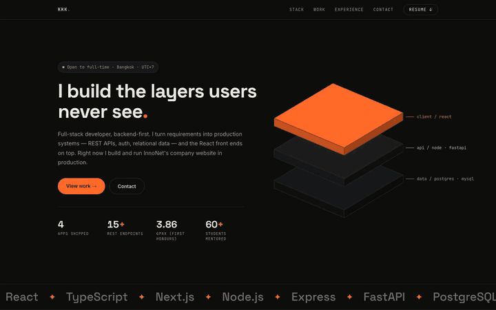

# Kaung Khant Kyaw — Portfolio

A motion-driven, single-page portfolio for a backend-first full-stack developer, built with React, GSAP and React Three Fiber.

**Live:** https://portfolio-kaung-khant-kyaw.vercel.app/



## Highlights

- **Hero intro:** headline lines rise out of a mask and the stats count up once.
- **3D stack, pinned scroll:** three WebGL plates (React Three Fiber) spread apart and slide left while each layer's skills come in beside it.
- **Plate → card handoff:** between the two pinned sections, the top plate morphs into the first project card.
- **Six-card project deck:** a pinned deck that snaps card to card, with a sliding index, an odometer counter, typed build logs, and a final 2 × 3 overview grid.
- **Marquee:** an infinite strip whose speed and direction follow scroll velocity.
- **Changelog and terminal reveals:** experience rows arrive like log lines as they enter the viewport, and the contact command types itself out.

## Tech stack

| | Version |
|---|---|
| React / React DOM | 19.2.4 |
| TypeScript | 5.9.3 |
| Vite | 7.3.1 |
| Tailwind CSS | 4.2.1 |
| GSAP (ScrollTrigger, SplitText) | 3.15.1 |
| @gsap/react | 2.1.2 |
| Motion | 14.14.0 |
| Lenis | 1.3.27 |
| three.js | 0.184.0 |
| React Three Fiber | 9.8.2 |

Fonts are self-hosted: Space Grotesk (headings), Inter (body) and JetBrains Mono (labels).

## How the motion is organised

Each library has one job, and no two of them animate the same element.

- **GSAP** runs the pinned and scrubbed timelines (the stack and the deck), the hero intro, the count-up, the changelog and the terminal typing. Everything is created inside `useGSAP()` so it cleans up on unmount and hot reload.
- **Motion** handles only the pointer tilt on the active deck card and the hover lift on overview tiles, on an inner wrapper GSAP never touches.
- **Lenis** provides smooth scrolling. It is driven by `gsap.ticker` and synced to ScrollTrigger.

**Two paths, chosen with `gsap.matchMedia`:**

- **Desktop** (at least 900px wide and 600px tall, motion allowed): pins, scrubbed timelines, WebGL plates, the handoff and the deck.
- **Small screens and reduced motion:** nothing is pinned. The stack is shown already spread out with its skills beside each plate, and the projects are a plain vertical list. Small screens with motion get CSS fade-ups and a constant-speed marquee.

**Lazy chunks, desktop only:** the 3D scene (three.js + React Three Fiber) and the project deck (with Motion) are separate chunks requested when the browser is idle. Small screens and reduced motion never download them.

**SVG fallback:** the plates are first drawn as an SVG at the same size the canvas will occupy, so the swap causes no layout shift. If WebGL is unavailable the SVG stays, and it spreads through the pinned section the same way.

## Accessibility & performance

- **Reduced motion:** no pins, no scrubbing, no smooth scroll, no WebGL. Every section is shown in its final state and in-page links jump instantly.
- **Hidden cards are inert:** in the deck, only the active card can be focused or read by a screen reader. In the overview grid, every tile can.
- **Keyboard:** Tab moves through the project index, then the active card's links. Enter on an index item scrolls to that card. Focus is always visibly outlined.
- **Screen readers:** the odometer and the typed terminal line are decorative (`aria-hidden`); a live "Project 2 of 6" text and the full command text are provided instead.

Lighthouse, measured against `vite preview`:

| | Performance | Accessibility | Best practices | SEO |
|---|---|---|---|---|
| Mobile (three runs) | 96 | 100 | 100 | 100 |
| Desktop | 100 | 100 | 100 | 100 |

JavaScript, gzipped:

| | Size |
|---|---|
| Main bundle | 137.24 kB |
| 3D chunk (lazy, desktop only) | 181.05 kB |
| Deck chunk (lazy, desktop only) | 37.14 kB |
| Total on mobile | 137.24 kB |
| Total on desktop | 355.43 kB |

## Flags

- `flags.enableFlipHandoff` in `src/data/content.ts` turns the plate → card handoff on or off. It is on by default.
- `?handoff=0` or `?handoff=1` in the URL overrides it for one visit, which is useful for comparing the two versions.

## Getting started

```bash
git clone https://github.com/Kaungkhantk3/portfolio_.git
cd portfolio_
npm install
```

| Command | What it does |
|---|---|
| `npm run dev` | Start the dev server |
| `npm run build` | Type-check and build for production |
| `npm run preview` | Serve the production build locally |
| `npm run lint` | Run ESLint |

CI runs on Node 20.

## Project structure

```
src/
├── components/
│   ├── layout/      nav and footer
│   ├── sections/    hero stage, marquee, stack, selected work, changelog, contact, handoff
│   ├── three/       the WebGL plate scene
│   ├── ui/          chips, headings, SVG plates, reveals
│   └── work/        project cards and the pinned deck
├── data/            content.ts (all copy)
├── hooks/           motion preferences, idle detection
├── lib/             GSAP setup, Lenis, anchors, shared scroll state
├── providers/       smooth scroll
├── App.tsx
└── index.css        design tokens and utilities
```

Components and data files from before the rebuild are still in the repo but are no longer rendered.

## Editing content

All copy lives in `src/data/content.ts`: navigation, hero text and stats, marquee items, stack layers, the six projects with their build logs, the changelog, contact details and the footer. Components read from that file and contain no text of their own.

## Known issues

- **`THREE.Clock` deprecation warning** in the browser console on desktop. It comes from React Three Fiber's internals, not from this code.
- **Safari is untested** at the time of writing. All checks were run in Chrome.

## Contact

**Kaung Khant Kyaw**

- Email: [kaungkhant.luke.dev@gmail.com](mailto:kaungkhant.luke.dev@gmail.com)
- LinkedIn: https://www.linkedin.com/in/kaung-khant-kyaw-66064627b/
- GitHub: https://github.com/Kaungkhantk3
